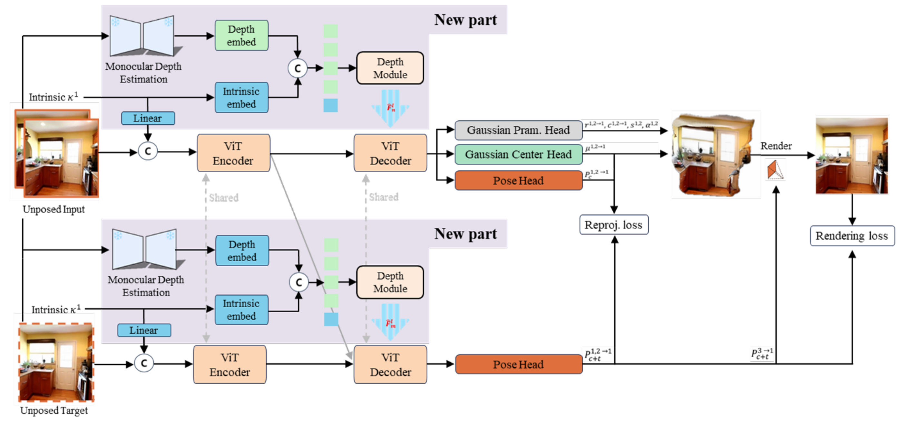
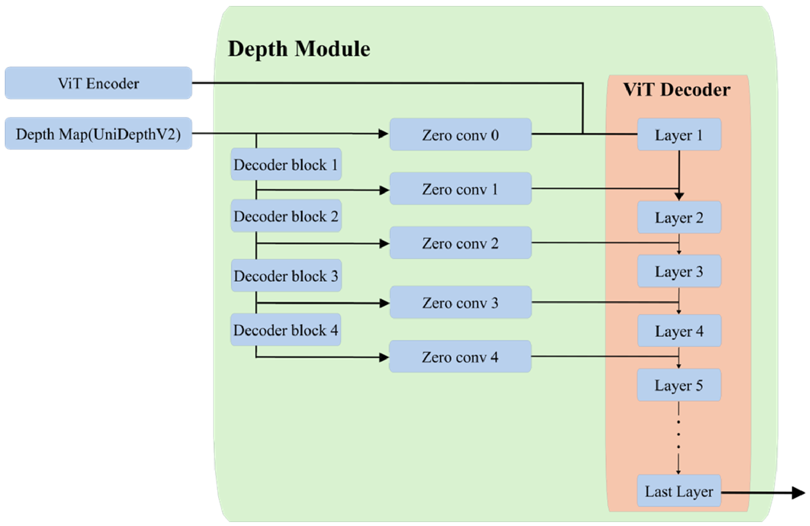
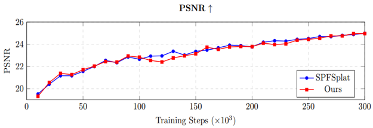
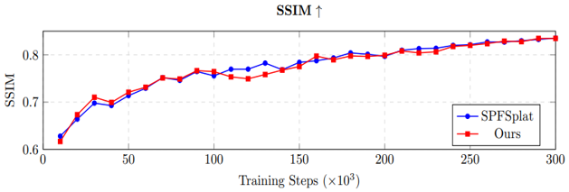
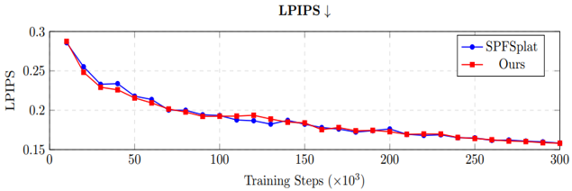
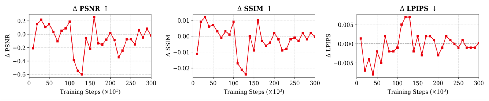

# Geometry-guided 3D Gaussian Splatting
**기하 정보 기반 3D Gaussian Splatting**

Hyeon-Sung Choi, Jong-Eun Ha*  
Seoul National University of Science and Technology

- Submitted to *Journal of Institute of Control, Robotics and Systems* (2026/04)
- Revised (2026/06) · Accepted (2026/06) · Published: Vol. 32, No. 8, pp. 1113–1122 (2026)

[](https://doi.org/10.5302/J.ICROS.2026.26.0108)
[](LICENSE)

> 🚀 This project is built on **[SPFSplat](https://github.com/ranrhuang/SPFSplat)** (Huang & Mikolajczyk, 2025) and uses **[UniDepthV2](https://github.com/lpiccinelli-eth/UniDepth)** as a frozen metric-depth prior.  
> The original SPFSplat README is kept at [`docs/README_SPFSplat.md`](docs/README_SPFSplat.md).

---

## Abstract

This study proposes a 3D Gaussian Splatting framework that improves the stability of scene reconstruction by integrating metric depth priors from UniDepthV2. Recent pose-free methods such as self-supervised pose-free 3D Gaussian splatting (SPFSplat) achieve remarkable results, but they still suffer from geometric instability during early training and inconsistent performance in complex scenes. To address this, we design a **Depth Module** that merges depth features extracted from UniDepthV2 into the transformer-based backbone of SPFSplat. A **zero-convolution-based injection** structure preserves the pretrained feature space, and **camera intrinsic tokens** provide stable geometric guidance. Experiments on RE10K show that the proposed framework converges more stably in the early training phase (20,000–60,000 steps) than the baseline and reaches comparable visual fidelity and geometric consistency at final convergence (300,000 steps).

## Keywords

3D Gaussian splatting · metric depth priors · feature integration · scene reconstruction · geometric stability · pose-free novel view synthesis

---

## Method

<p align="center">
  
  <br>
  <em>Fig. 1. Overall architecture. The shaded "New part" is the proposed geometry path: a frozen monocular depth estimator (UniDepthV2) and an intrinsic embedding feed the Depth Module, which is injected into the shared ViT decoder.</em>
</p>

<p align="center">
  
  <br>
  <em>Fig. 2. Depth Module. The UniDepthV2 depth map is un-projected to a 3D point map, encoded by a small ViT, and added to every decoder layer through zero-initialized convolutions so that the pretrained SPFSplat features are untouched at the start of training.</em>
</p>

Pipeline:

1. **Metric depth prior** – a frozen UniDepthV2 (ViT-L/14) predicts a metric depth map for each context view.
2. **Un-projection** – the depth map is lifted to a camera-space 3D point map `X_j = d_j K^{-1} p_j` and normalized per axis ([`src/geometry/unproject_uni.py`](src/geometry/unproject_uni.py)).
3. **Geometry encoder** – the point map is patch-embedded and passed through lightweight decoder blocks.
4. **Zero-convolution injection** – each block output goes through a zero-initialized 1×1 convolution and is added to the corresponding ViT decoder layer ([`backbone_croco.py`](src/model/encoder/backbone/backbone_croco.py), `make_zero_conv`).
5. **Intrinsic token** – normalized camera intrinsics are embedded as an extra token so the geometry path is scale-aware.

Compute overhead (RTX 3090, 256×256): about **+32.7M trainable parameters** (geometry encoder, zero convs, intrinsic adapter) over the 629M baseline, plus one frozen UniDepthV2 forward per context view (**≈42.5 ms, ≈2.5 GB** per view). UniDepthV2 receives no gradients.

---

## Results

Evaluation protocol follows SPFSplat (2 context views, 256×256). SelfSplat and NoPoSplat numbers are quoted from the SPFSplat paper; NoPoSplat uses evaluation-time pose alignment.

**Table 1. Novel view synthesis on RE10K** (PSNR↑ / SSIM↑ / LPIPS↓)

| Method | Small PSNR | SSIM | LPIPS | Medium PSNR | SSIM | LPIPS | Large PSNR | SSIM | LPIPS | **Avg PSNR** | **SSIM** | **LPIPS** |
|---|---|---|---|---|---|---|---|---|---|---|---|---|
| SelfSplat | 14.828 | 0.543 | 0.469 | 18.857 | 0.679 | 0.328 | 23.338 | 0.798 | 0.208 | 19.152 | 0.680 | 0.328 |
| NoPoSplat | 22.514 | 0.784 | 0.210 | 24.899 | 0.839 | 0.160 | 27.411 | 0.883 | 0.119 | 25.033 | 0.838 | 0.160 |
| SPFSplat | 22.498 | 0.778 | 0.208 | 24.846 | 0.836 | 0.158 | 27.347 | 0.884 | 0.117 | 24.986 | 0.835 | 0.158 |
| **Ours** | 22.476 | 0.777 | 0.207 | 24.859 | 0.836 | 0.158 | 27.275 | 0.882 | 0.117 | 24.965 | 0.835 | 0.158 |

**Table 2. Novel view synthesis on ACID** (PSNR↑ / SSIM↑ / LPIPS↓)

| Method | Small PSNR | SSIM | LPIPS | Medium PSNR | SSIM | LPIPS | Large PSNR | SSIM | LPIPS | **Avg PSNR** | **SSIM** | **LPIPS** |
|---|---|---|---|---|---|---|---|---|---|---|---|---|
| SelfSplat | 18.301 | 0.568 | 0.408 | 21.375 | 0.676 | 0.314 | 25.219 | 0.792 | 0.214 | 22.089 | 0.694 | 0.298 |
| NoPoSplat | 23.087 | 0.685 | 0.258 | 25.624 | 0.777 | 0.193 | 28.043 | 0.841 | 0.144 | 25.961 | 0.781 | 0.189 |
| SPFSplat | 22.512 | 0.657 | 0.267 | 25.510 | 0.768 | 0.194 | 28.478 | 0.852 | 0.137 | 25.945 | 0.775 | 0.188 |
| **Ours** | 22.365 | 0.651 | 0.271 | 25.213 | 0.754 | 0.202 | 28.225 | 0.844 | 0.140 | 25.691 | 0.765 | 0.194 |

**Table 3. Camera pose estimation (AUC↑)**

| Method | RE10K 5° | 10° | 20° | ACID 5° | 10° | 20° |
|---|---|---|---|---|---|---|
| SelfSplat | 0.207 | 0.392 | 0.576 | 0.205 | 0.363 | 0.531 |
| NoPoSplat | 0.572 | 0.728 | 0.833 | 0.335 | 0.497 | 0.645 |
| SPFSplat | 0.590 | 0.735 | 0.832 | 0.387 | 0.535 | 0.665 |
| **Ours** | 0.466 | 0.666 | 0.797 | 0.250 | 0.394 | 0.532 |

**Table 4. Early-training convergence on RE10K** (Ours − SPFSplat)

| Step | PSNR (SPFSplat) | PSNR (Ours) | ΔPSNR | ΔSSIM | ΔLPIPS |
|---:|---:|---:|---:|---:|---:|
| 10,000 | 19.527 | 19.317 | −0.210 | −0.011 | +0.001 |
| 20,000 | 20.405 | 20.554 | **+0.149** | **+0.009** | **−0.007** |
| 30,000 | 21.165 | 21.381 | **+0.216** | **+0.012** | **−0.004** |
| 40,000 | 21.166 | 21.269 | **+0.103** | **+0.006** | **−0.008** |
| 50,000 | 21.561 | 21.709 | **+0.148** | **+0.007** | **−0.002** |
| 60,000 | 21.998 | 22.032 | **+0.034** | **+0.003** | **−0.005** |
| 70,000 | 22.550 | 22.444 | −0.106 | −0.001 | +0.002 |
| 80,000 | 22.344 | 22.394 | +0.050 | +0.003 | −0.002 |
| 90,000 | 22.858 | 22.944 | +0.086 | +0.001 | −0.002 |
| 100,000 | 22.648 | 22.835 | +0.187 | +0.009 | −0.001 |

<p align="center">
  
  
  
  <br>
  <em>Fig. 3. PSNR / SSIM / LPIPS over training steps on RE10K.</em>
</p>

<p align="center">
  
  <br>
  <em>Fig. 4. Difference relative to SPFSplat (Ours − SPFSplat). The advantage is clearest in the 20k–60k step range.</em>
</p>

**Summary.** Final NVS quality is on par with SPFSplat (RE10K avg PSNR 24.965 vs 24.986), while the geometric prior makes early training noticeably more stable. Pose-estimation AUC drops, which we attribute to the metric-geometry constraint limiting the freedom of pose regression; see the paper for discussion.

---

## What was changed relative to SPFSplat

| File | Change |
|---|---|
| `src/model/encoder/backbone/backbone_croco.py`, `backbone_croco_multiview.py` | Depth Module: point-map patch embedding, geometry decoder blocks, `make_zero_conv`, per-layer zero-conv injection, intrinsic-token adapter |
| `src/geometry/unproject_uni.py` | **New.** Depth → 3D point map un-projection + per-axis normalization (Eq. 1) |
| `src/model/encoder/heads/depth_head.py` | **New.** Frozen UniDepthV2 wrapper producing pseudo metric depth |
| `src/model/model_wrapper.py` | Calls the depth head, feeds point maps to the backbone, depth visualizations |
| `src/loss/loss_depth.py`, `config/loss/depth.yaml` | **New.** Optional depth-consistency loss |
| `src/dataset/dataset_re10k.py`, `src/dataset/shims/crop_shim.py` | Pass raw (un-normalized) images for UniDepthV2 |
| `src/unidepth/` | Vendored UniDepthV2 model code (Apache-2.0, see upstream repo) |
| `config/model/encoder/head/*` | UniDepthV2 head config |

---

## Setup

See [`setup.md`](setup.md) for the full environment. Short version:

```bash
git clone https://github.com/HyeonSung11/Geometry-Guided-3DGS
cd Geometry-Guided-3DGS

conda create -n gg3dgs python=3.11 -y
conda activate gg3dgs
conda install pytorch torchvision pytorch-cuda=12.1 -c pytorch -c nvidia
pip install -r requirements_uni.txt
pip install -e diff-gaussian-rasterization      # pose-aware rasterizer
pip install git+https://github.com/lpiccinelli-eth/UniDepth.git   # unidepth package

# pretrained weights (not included in this repo)
mkdir -p pretrained_weights
# MASt3R backbone for training init:
#   https://download.europe.naverlabs.com/ComputerVision/MASt3R/MASt3R_ViTLarge_BaseDecoder_512_catmlpdpt_metric.pth
# SPFSplat re10k.ckpt (optional, for comparison): https://huggingface.co/RanranHuang/SPFSplat
# UniDepthV2 weights are downloaded automatically from Hugging Face (lpiccinelli/unidepth-v2-vitl14).
```

Datasets (RE10K, ACID) follow the SPFSplat / pixelSplat format: see [`DATASETS.md`](DATASETS.md) and place them under `datasets/`.

## Running

```bash
# Train on RE10K (2 views)
python -m src.main +experiment=spfsplat/re10k wandb.mode=online wandb.name=gg3dgs_re10k

# Evaluate novel view synthesis on RE10K
python -m src.main +experiment=spfsplat/re10k mode=test wandb.name=gg3dgs_re10k \
    dataset/view_sampler@dataset.re10k.view_sampler=evaluation \
    dataset.re10k.view_sampler.index_path=assets/evaluation_index_re10k.json \
    checkpointing.load=<path/to/checkpoint.ckpt> \
    test.save_image=true test.align_pose=false

# Evaluate pose estimation
python -m src.eval_pose +experiment=spfsplat/re10k +evaluation=eval_pose mode=test wandb.name=gg3dgs_re10k \
    checkpointing.load=<path/to/checkpoint.ckpt> \
    dataset/view_sampler@dataset.re10k.view_sampler=evaluation \
    dataset.re10k.view_sampler.index_path=assets/evaluation_index_re10k.json
```

Training in the paper: single NVIDIA A100, batch size 4, AdamW, lr 1.5e-4 with 2,000-step linear warm-up, backbone lr ×0.1, gradient clipping 0.5, 300,000 steps. Evaluation on 2× RTX 3090.

---

## Citation

```bibtex
@article{choi2026geometry,
  title   = {Geometry-guided 3D Gaussian Splatting},
  author  = {Choi, Hyeon-Sung and Ha, Jong-Eun},
  journal = {Journal of Institute of Control, Robotics and Systems},
  volume  = {32},
  number  = {8},
  pages   = {1113--1122},
  year    = {2026},
  doi     = {10.5302/J.ICROS.2026.26.0108}
}
```

Please also cite the base works:

```bibtex
@article{huang2025spfsplat,
  title   = {No Pose at All: Self-Supervised Pose-Free 3D Gaussian Splatting from Sparse Views},
  author  = {Huang, Ranran and Mikolajczyk, Krystian},
  journal = {arXiv preprint arXiv:2508.01171},
  year    = {2025}
}
@inproceedings{piccinelli2025unidepthv2,
  title     = {UniDepthV2: Universal Monocular Metric Depth Estimation Made Simpler},
  author    = {Piccinelli, Luigi and Sakaridis, Christos and Yang, Yung-Hsu and Segu, Mattia and Li, Siyuan and Abbeloos, Wim and Van Gool, Luc},
  booktitle = {arXiv preprint arXiv:2502.20110},
  year      = {2025}
}
```

## Acknowledgements

This code is built upon [SPFSplat](https://github.com/ranrhuang/SPFSplat), which in turn builds on [NoPoSplat](https://github.com/cvg/NoPoSplat), [pixelSplat](https://github.com/dcharatan/pixelsplat), [DUSt3R](https://github.com/naver/dust3r) and [CroCo](https://github.com/naver/croco). Metric depth priors come from [UniDepthV2](https://github.com/lpiccinelli-eth/UniDepth). The pose-aware rasterizer is from [slothfulxtx/diff-gaussian-rasterization](https://github.com/slothfulxtx/diff-gaussian-rasterization). We thank the authors for releasing their work.

## License

MIT, following SPFSplat. Vendored third-party code (`src/unidepth`, `diff-gaussian-rasterization`) keeps its original license.
